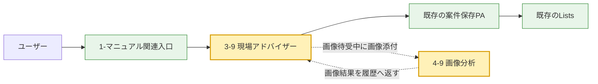
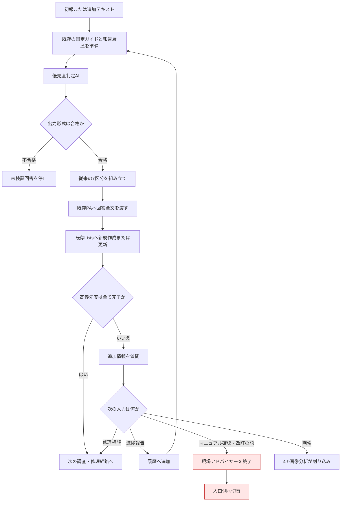
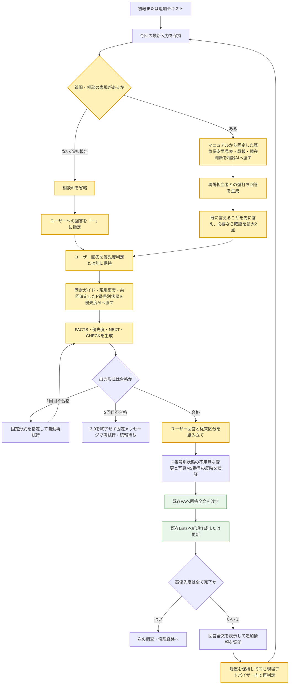
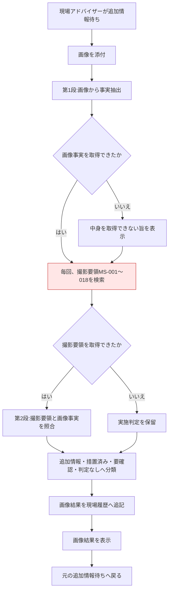
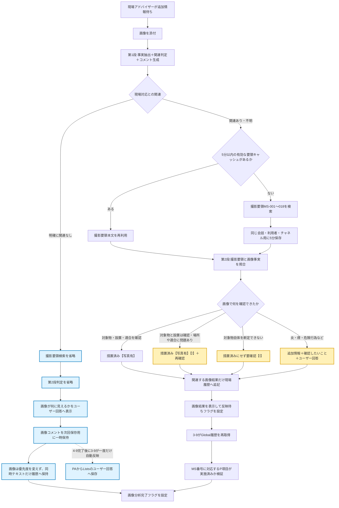
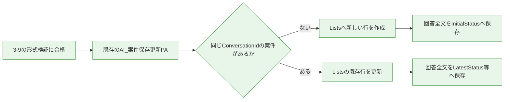

# 現場アドバイザー・画像分析の変更前後フロー

## 全体像

今回変更するのは、Copilot Studioの「3-9 現場アドバイザー」と「4-9 画像分析」だけです。既存の案件保存PAとListsは、変更前・変更後とも同じものを使います。



黄色が今回の変更対象、緑が変更しない部分です。

---

# 1. 現場アドバイザー

## 変更前



### 変更前の要点

1. 出力は `【確認できた事実】` から始まり、`【ユーザーへの回答】` はありません。
2. 進捗報告は履歴へ追加して再判定できます。
3. 現場対応中にマニュアル確認などの語を送ると、現場アドバイザーを終了して入口側へ切り替えます。
4. 一般的な相談文は、進捗報告として扱われるか、入口・マニュアル検索側へ流れる可能性があります。
5. PA・Listsへの保存は、形式検証に合格した後に行います。

## 変更後



### 変更後の出力

```text
【ユーザーへの回答】
└質問がある場合は、マニュアル早見表と既報に沿った壁打ち回答
または
ー

【確認できた事実】
（以下は従来どおり）

【初動措置　優先度：高】
...
```

### 重要な分離

- `【ユーザーへの回答】` は相談への返答で、優先度AIとは別経路です。
- `【確認できた事実】` と優先度は、報告済みの現場事実から判定します。
- 質問文とAI回答そのものでは優先度を変更しませんが、同じ文に含まれる具体的な警報・不在・臭気等は現場事実として反映します。
- 相談経路ではライブ検索を行わないため、検索0件のシステム文を出しません。
- 優先度AIの内部出力は変更前と同じ `[[FACTS]]` 開始なので、回答欄の生成失敗を理由に優先度全体を不合格にしません。
- 前回の `対応済み` / `対応済み【!】` はP番号別に保持し、同じ項目を更新する明示情報がなければ変更できません。
- 形式不正が続いてもEndDialogせず、親エージェントの自由回答へ落としません。

---

# 2. 画像分析

## 変更前



### 変更前の要点

1. 画像が現場と無関係でも、撮影要領検索と第2段判定へ進みます。
2. 撮影要領を画像ごとに取得します。
3. 無関係画像について、利用者への分かりやすい説明欄はありません。
4. 対象物は確認できるが設置場所を判定できない場合は、主に `要確認` として扱います。

## 変更後



### 関連判定の基準

- `関連あり`：MS対象物、ガス設備、臭気・漏えい、検知、炎、煙、破損、危険行為などが見える
- `関連なし`：鉢植え、食事、一般風景などだけで、現場要素がないと明確に判断できる
- `不明`：画像が不鮮明、対象物の一部かもしれないなど、見落としの可能性がある

`不明` は安全側として、撮影要領の照合を続けます。

### 警告付き対応済み

```text
└ポケット警報器等の設置：対応済み【!】
　根拠：本体と設置は写真で確認できるが、設置場所の周辺範囲は未確認
```

対象物自体がボケていて識別できない場合は、誤判定を避けるため `対応済み【!】` ではなく `要確認` です。

---

# 3. PA・Listsの流れ

変更前も変更後も同じです。



- PAのフローIDは変更しません。
- PAへ渡す `text_2` は、変更後も回答全文です。
- Listsの列追加はありません。
- 新しい `【ユーザーへの回答】` と `対応済み【!】` も、既存列内の回答本文として保存されます。
- Power Appsで `【ユーザーへの回答】` を専用欄に表示する場合だけ、Apps側の表示式を追加します。

---

# 4. 変更点の比較表

| 項目 | 変更前 | 変更後 |
|---|---|---|
| 進捗報告 | 優先度を再判定 | 同じ。回答欄は `ー` |
| 現場対応中の相談 | 進捗扱い、または入口へ切替の可能性 | マニュアル由来の固定早見表と既報で、回答と優先度を同時表示 |
| マニュアル検索0件 | 回答停止につながる可能性 | 相談経路ではライブ検索せず、0件表示を出さない |
| 出力見出し | 従来の7区分 | 先頭に `【ユーザーへの回答】` を追加 |
| 無関係画像 | 撮影要領検索と第2段を実行 | 両方を省略して説明だけ返す |
| 不鮮明画像 | 照合へ進む | `不明` として照合へ進む |
| 撮影要領 | 画像ごとに検索 | 条件が同じ場合は5分再利用 |
| 設置済み・位置不明 | 主に要確認 | `対応済み【!】` と再撮影・是正確認 |
| 後続の無関係な進捗 | 対応済み【!】が再生成で消える可能性 | P番号別状態を維持し、変更を保存前に拒否 |
| 画像から確認した措置 | 3-9が先に動くと要確認へ戻る可能性 | 4-9完了後に一度だけ反映し、MS番号との整合を検証 |
| 形式不正 | トピック終了後に自由回答へ落ちる可能性 | 1回再試行し、再失敗しても3-9内で待機 |
| 対象物自体が不明 | 要確認 | 同じ。対応済みにはしない |
| PA | 既存PA | 変更なし |
| Lists | 既存列 | 変更なし |

