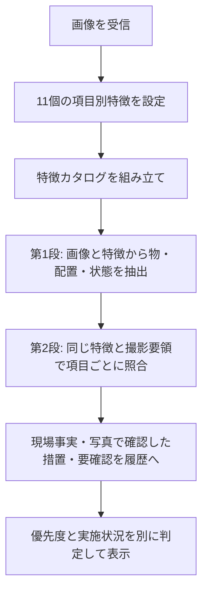

# 今回の導入とアイテム別の特徴編集

今回の修正は、**3-9のYAMLと4-9のYAMLを一緒に更新**する。全体「指示」と入口YAMLは640af62と同一で、前回版を導入済みなら変更不要。

## 最初の導入

1. 現在の緊急保安・画像分析の2トピックのYAMLを控える。
2. [3-9のYAML全文](3-9-緊急保安業務エージェント_optimized.yaml)をGitHubのRaw表示から全文コピーし、既存の緊急保安トピックのコードエディターへ全文置換して保存する。
3. [4-9のYAML全文](4-9-画像分析エージェント_緊急保安_optimized.yaml)を同様に、既存の画像分析トピックへ全文置換して保存する。外側の画像カスタムプロンプト本文、AI Builderモデル参照、ContextText／ImageInputのバインドは変更不要。
4. トピックチェッカーを確認し、新しい会話で写真と現場報告を使ってテストする。消防・警察が高欄へ入ること、写真の3項目を別々に照合すること、確認文が説明文になることを確認する。
5. 公開チャネルでは実機確認後に公開する。

## 今後「ポケット警報器だけ」を直す方法

画像分析トピックの先頭に、アイテム別の「変数を設定する」ノードを11個設けた。ポケット警報器の場合は、**Topic.特徴_ポケット警報器**を設定しているノードを開き、その値だけを編集して保存する。他のアイテムの定義や、後続の分析ロジックを直す必要はない。

コードエディターで探す場合は、`id: setVariable_imageFeature02`。そのノードの`value`が特徴の指示文。Power Fx文字列の外側の引用符・YAMLのインデントを保つ。新たに半角の引用符を文中で使う場合は、Power Fx文字列内では`""`にする。文面は下記の個別MDにも保存してある。

| ノードID末尾 | 変数 | 編集用の特徴文 |
|---|---|---|
| imageFeature01 | Topic.特徴_火気厳禁表示シート | [火気厳禁表示シート](image_features/01_火気厳禁表示シート.md) |
| imageFeature02 | Topic.特徴_ポケット警報器 | [ポケット警報器](image_features/02_ポケット警報器.md) |
| imageFeature03 | Topic.特徴_可燃性ガス検知器と排水口調査 | [検知器と排水口調査](image_features/03_可燃性ガス検知器と排水口調査.md) |
| imageFeature04 | Topic.特徴_消火器 | [消火器](image_features/04_消火器.md) |
| imageFeature05 | Topic.特徴_メーターガス栓 | [メーターガス栓](image_features/05_メーターガス栓.md) |
| imageFeature06 | Topic.特徴_分岐バルブ等 | [分岐バルブ等](image_features/06_分岐バルブ等.md) |
| imageFeature07 | Topic.特徴_窓扉と換気 | [窓・扉と換気](image_features/07_窓扉と換気.md) |
| imageFeature08 | Topic.特徴_濃度表示 | [濃度表示](image_features/08_濃度表示.md) |
| imageFeature09 | Topic.特徴_保安柵等 | [保安柵等](image_features/09_保安柵等.md) |
| imageFeature10 | Topic.特徴_消防警察等 | [消防・警察等](image_features/10_消防警察等.md) |
| imageFeature11 | Topic.特徴_既存ホワイトシート | [基準版に残る既存項目](image_features/11_既存ホワイトシート.md) |

各IDの実際の接頭辞は`setVariable_`。今回は既存MS-018の有無を変えていない。特徴文を変えたら、対象を含む写真と含まない写真の両方で再確認する。

## 分析時にどう読まれるか



一つのアイテムが読めないことを理由に全項目を未確認にしない。機器の存在、設置場所の適合、調査の実施、濃度の可読性を分ける。手が写っていなくても、採取ホース等と排水口の関係・使用状態が確認できれば検知器調査の照合対象にする。単に置いた機器だけで測定中と断定しない。

**GitHubのMDを編集しただけで、稼働中のStudioが自動取得する構成ではない。** Studioで直接その変数ノードを編集するか、リポジトリの個別MDを編集して下記でYAMLを再生成し、4-9を適用する。SharePoint等の外部サービスや架空のPower Automateフローは追加していない。

```bash
python SUBARU_optimized/validation/rebuild.py
```

## 優先度表示は何が変わったか

AIが高・中・低の欄全体を自由に書く方式をやめ、措置ごとの優先度・状態・根拠を返す内部形式にした。YAMLはその優先度に従って表示欄を組み立てる。緊急連動が高の場合は消防・警察と避難誘導を両方高に統一する。未実施／要確認の高措置から完了状況も計算する。

この仕組みは「高という判定を低欄へ置く」配置ミスを防ぐ。現場事実から高と判断する意味の正確さまで機械的に証明するものではない。実モデルで今回の事例を確認する。親AIがトピック外で回答する場合はこの処理を通らないため、必要なら[生成元の確認手順](14_今回の導入と様式逸脱の確認.md)も参照する。

## 一つのアイテムだけ読めないときの切り分け

Studioの実行履歴で次の順に確認する。

| 状況 | 確認・修正する場所 |
|---|---|
| Topic.画像事実に、そのアイテムが識別されていない | 対象の特徴ノードだけを修正し、再度写真で試す |
| Topic.画像事実では識別されているが、Topic.要領照合結果で設置・調査が落ちる | 同じ特徴の設置・調査条件と、撮影要領本文・MS-IDの照合を確認。数値不鮮明だけで設置を落としていないか確認 |
| 写真の措置済みにはあるが、現場回答に反映されない | Global.緊急保安追加情報履歴への追記と、元トピックへの復帰・対象場所の対応を確認 |
| 新しい特徴を保存したのに改善が見えない | 対象変数、Topic.画像特徴カタログ、Topic.第1段プロンプトに新しい文面が入っているか確認。公開版とテスト版の差も確認 |

優先度の切り分けでは、`Topic.優先度表示原文`に保持した内部結果のP11（消防・警察）とEMERGENCYを確認する。P11が高、またはEMERGENCYが高なら、今回の組立処理は高欄に置く。これと表示が異なる場合は古い版・別の応答経路を確認する。P11の判定値自体が低で理由だけ高と言っている場合は、表示配置ではなくAIの判定内容の不整合として確認する。

## 「確認したいこと」の文章例

以下は期待する文面の例であり、実機の生成結果ではない。

> 別室は不在で入室できず、玄関扉の隙間からLEL1％が検知されているため、消防・警察への要請と避難誘導は既に高と判断できます。追加の回答を待たず、提示した高優先度の措置を進めてください。上流側の遮断方法を判断するため、建物種別と、操作できる分岐バルブ等があるかを教えてください。窓から屋外の臭気が入ったとのことなので、換気方法を判断するため、屋外の流入元の調査で分かったことも教えてください。

報告が十分なときは、質問を増やさず「優先度判断に必要な情報は確認できています。提示した未完了の高優先度の作業を進めてください」と案内する。判断できることと、残る確認を分ける。

## 検証と戻し方

静的検査・回帰48件、Microsoft.PowerFx.Interpreter 1.8.1による337式の構文・型、目的番号45入力、措置別の振分け・不正形式21ケース、11項目の特徴が両段の指示へ渡ることを確認した。画像そのものの認識やStudioの実会話を実行した結果ではない。

[修正内容・変数・競合・3YAML全文・実機確認計画](15_措置別振分けと画像特徴分離_YAML全文.md)、[前回640af62からの差分](diffs/itemized_640af62/)、[テストログ](validation/contract_tests.log)、[式と特徴文の受渡しの検証結果](validation/native_restart/results.json)を参照。

今回分を戻す場合は3-9と4-9を640af62時点の同名ファイルへ戻す。入口と全体「指示」は変えていない。
