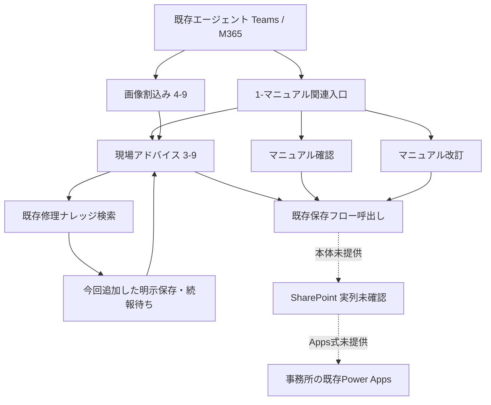

# 調査と設計

基準：`4fa63fbcfc1ccf39d063276d9999a5ffb3166132` の `SUBARU_optimized/`。ユーザー指定の `61e0c4a` から続いた修正版の最新ファイルを別パックにコピーし、既存ディレクトリは変更していません。11月4日の依頼は `source/改修指示_20261104.md` に保存しています。

## 確認できた現行経路

既存保存フローは `9a770168-65a8-f111-aaad-7ced8d2f9cab`。現場・確認・改訂から6か所の既存フロー呼出しを確認しました（索引フローを含む）。個々の入力は `validation/source_audit.json` に記録しています。`case_id` の返却先が `Topic.案件ID` でも、案件IDなのかSharePoint行IDなのかは確定できません。

フロー本体、実サイトURL・リストGUID・内部列名、.msapp、Apps式、Teams/M365実行履歴はありません。候補名 `TGNW_アプリ維持管理サイト` / `AI_エージェント可視化` は確定値として使っていません。**Teamsだけ保存されない根本原因は未特定**です。接続権限やTeams公開版の差をコードだけで断定していません。

ソースで確定できた不足は、修理の最終回答がSendActivity→EndDialogで終了し、保存呼出しを通らないことです。これを明示保存→続報待ちへ変更しました。現場回答には既に保存呼出しがあるため、見た目だけの変更では実環境の保存原因を解決できません。

## 今回の処理

- 判定結果は一度だけ確定。既存 `setVariable_itemRender` が作るApps用文字列を維持し、同じ判定行からTeams用表示と比較データを組み立てます。表示整形・差分のための生成AI呼出しは追加していません。
- 措置名と安定IDの対応は `contracts/measures.json`。P01〜P23は既存判定の識別子です。MS番号を読み替えていません。理由の言い換えは変更扱いにしません。優先度変更、状態変更、新規項目、今回未判定を分けます。
- 初回は①なし。同一案件の2回目以降は①を表示。比較元が取得できない・別案件・旧レコードに比較データがない場合は「前回比較は現在できません」。未確認や写真範囲外を解消とは扱いません。
- 互換版では会話内キャッシュと既存フローの返却IDが一致する場合だけ比較。返却IDが毎回変わる環境では永続比較を保証しません。接続版では実CaseId＋所有者＋現場種別で最新1件を読みます。
- 同じチャットは現案件を継続。「新しい案件」で履歴と比較元を明示リセット。別チャットからは先頭行 `案件ID=実際の案件ID` で再開可能です（接続版のみ保存済み事実を取得）。別人の記録を所有者条件だけで参照しません。
- 修理の最終回答・追加質問を表示と同じ文字列で保存経路へ渡します。工法候補の番号選択画面は中間画面で、最終修理回答の保存対象とは別です。既存マニュアル検索と不足情報の扱いは維持しています。
- 写真は1投稿最大5添付を順番に処理。対応する実データはPNG/JPEG。HEIC/WebPやTeams添付メタデータは解析済みにしません。従来の項目別特徴・モデル・ナレッジ参照を保持しています。
- 画像後は同じ3-9を「画像単発」で呼び、返信後すぐ戻します。再び質問待ちを積み重ねない構造です。元の質問待ちへ続報を送れるようにしています。

## 主要な追加変数・分岐

| 用途 | 変数・分岐 |
|---|---|
| チャネル・案件 | `Topic.投稿チャネル`、`案件比較キー`、`案件所有者`、`明示案件指定`、`案件継続` |
| 今回と前回 | `Topic.今回現場スナップショット`、`前回現場スナップショット`、`前回比較状態`、`優先度変更点` |
| 表示 | `Topic.Teams現場回答`、既存 `優先度判定結果` はApps用のまま |
| 会話内保持 | `Global.TeamsCaseKey`、`TeamsCaseOwner`、`TeamsLastFieldSnapshot`、`TeamsLastCaseId`、`TeamsFieldReportCount` |
| 修理からの復帰 | `Topic.修理最終回答`、`修理後入力`、`conditionGroup_teamsFieldUpdateDuringRepair*` |
| 画像の上限 | `Topic.画像添付番号`、`画像処理上限`、`画像処理枚数`、`画像処理注意` |
| 単発画像再判定 | 既存3-9の省略可能なString入力 `判定応答方式`。通常／画像単発 |
| 接続版の保存確認 | `保存応答状態`、`保存応答Teams文`、`保存エラーコード`、`案件読込状態` |

追加の会話変数は主にString、画像カウンターと報告回数はNumberです。修理用の旧フロー返却値は既存の実型が不明なので型を決め打ちして初期化していません。

## 残る境界

保存アダプターは追記型の履歴保存に対応します。現行がCaseIdごとの更新型なら生成を止め、既存更新処理を保持して履歴の読み方を調整する必要があります。Appsの受信式や更新・通知の意味を変更して本番へ強行適用してはいけません。

同一会話で案件を切り替える場合、モデルの推測で分けず明示コマンドを使います。別チャット・M365との横断再開には、実CaseIdと認証IDの対応確認が必要です。所有者キーはデータの絞り込み条件であり、SharePointのアクセス権そのものではありません。
